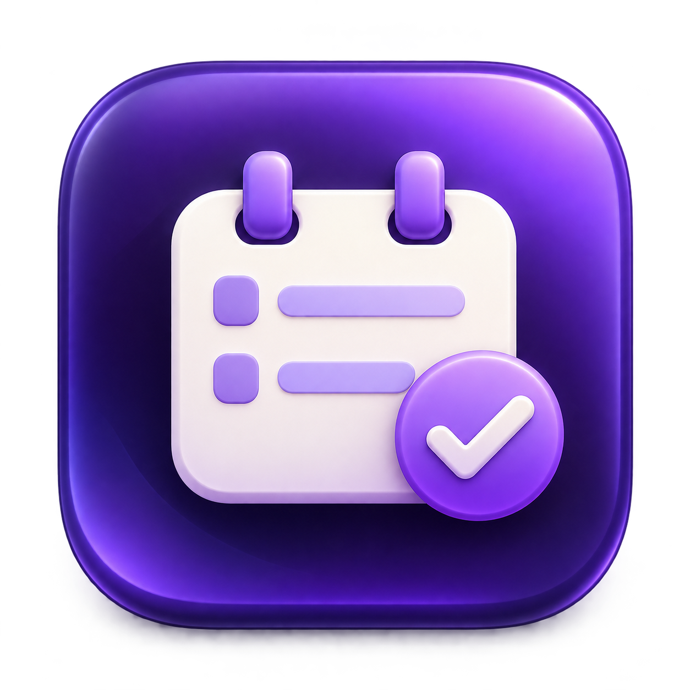

<p align="center">
  
</p>

# ObsidianPlannerForApple

在 Obsidian 内预览 Day Planner 安排，逐条选择添加、跳过、更新或再次添加，再同步到苹果提醒事项和可选日历。插件调用单独安装的 Mac App；iPhone 通过 iCloud 查看，无需同步整个 Obsidian Vault。

A macOS app and Obsidian companion plugin for previewing Day Planner schedules, choosing an action per plan, and exporting to Apple Reminders with optional Calendar events. View plans on iPhone through iCloud.

**Beta 软件 · Apple silicon · 未经 Apple 公证。** 当前只在开发者的 Mac 上完成主要流程验证，尚未全面验证其他 macOS 版本。

[下载已发布版本 / Downloads](https://github.com/YuchenWang-leslie/ObsidianPlannerForApple/releases) · [MIT + Commons Clause](LICENSE)

> **候选版本 v0.5.0-beta.1：App 0.5.0 / build 6，插件 0.3.0，bridge protocol 1。** 自动测试、构建及只读原生检查通过；新版真实写入验收等待测试 Vault 的配对和系统授权，尚未公开发布。以下说明针对候选版本，旧公开 App 不支持插件同步。App 可独立使用，插件需要另外安装匹配的 App。

## 本次更新 / What’s new

**在 Obsidian 完成预览与同步：** 侧栏按钮和命令面板打开本周、下周或自定义范围；预览按日期展示安排、匹配状态、格式问题和源日记链接。每条安排可选择添加、跳过、更新或再次添加；冲突可明确关联旧条目、创建新条目或跳过。权限和目标账户仍在 Mac App 设置。

新安排默认 Add，已添加过的安排默认 Skip，包括日记中有修改的条目。Update existing 会将源标题、时间、完成状态和本次通知设置写入关联条目；Add again 保留旧条目，并把后续更新关联到新副本。

预览会核对已保存的源文件、Day Planner 配置和本机历史。提交前发生变化须重新预览；App 重启或预览过期也需刷新。执行后或改变范围／选项时清除本次选择。请求状态可查询；超时、关闭窗口或停用插件不会自动提交新一轮同步，也不保证中止已经开始的本机写入。

**升级请保留 `~/Library/Application Support/ObsidianPlanner/`。** P2 的只读配对可继续预览，但同步需要在 App 重新明确批准 preview-and-sync 配对。如果只修改通知设置，选择 Update existing 才会应用；部分失败后先检查苹果条目，再重新预览并以 Update existing 重试未完成条目，避免 Add again 创建额外副本。

[完整更新记录 / Changelog](CHANGELOG.md) · [本版本说明 / Release notes](docs/releases/v0.5.0-beta.1.md)

## 功能

- 本周、下周、自定义日期范围（含过去日期）；每周从周一开始。
- 默认只生成 **DayPlanner 提醒事项**；可选同时生成 **DayPlanner 日历事件**。
- 默认提前 10 分钟提醒，可调整时间、关闭通知或选择通知渠道。
- 常用时区菜单、全部时区搜索，以及使用系统时区。
- 同步前预览；每条安排可单独选择跳过、更新或再次添加，未添加过的安排默认添加。
- Obsidian 内配对、预览、逐条操作、同步结果及上次同步状态查询；共用原生解析器、执行器和历史。
- 无法自动匹配时，可手动关联旧条目或明确作为新条目创建。
- 只读 Obsidian 文件，无服务器、无独立 App 账户。

## 安装与首次打开

1. 从 [Releases](https://github.com/YuchenWang-leslie/ObsidianPlannerForApple/releases) 下载 `ObsidianPlanner-…-macOS-arm64.zip`，解压。
2. 将 `ObsidianPlanner.app` 拖入「应用程序」。当前安装包适用于 **M 系列芯片 Mac**；未提供 Intel 安装包。
3. 尝试打开 App。如果 macOS 因开发者未经验证／未公证而阻止打开，在确认下载来源可信后，可到 **系统设置 → 隐私与安全性 → 仍要打开**，核对 App 名称后确认。受组织管理的 Mac 可能不允许此操作。参见 [Apple 官方说明](https://support.apple.com/en-us/102445)。
4. 本 App 没有 Developer ID 签名，也没有经过 Apple 公证。仅在信任此项目时安装；无需关闭系统的整体安全保护。

**系统要求：** Apple silicon；构建最低目标 macOS 14。实际测试环境为 macOS 27.0.1 / Obsidian 1.15.1。插件 manifest 声明最低 Obsidian 1.5.0，但这不表示已在所有中间版本验证；macOS 14–26 和 Intel 未完成运行兼容性测试。

### 安装 Obsidian 插件

1. 先安装并打开上述 **App 0.5.0**。插件不下载或内置原生程序，旧的公开 App 不支持本版同步。
2. 下载同一 Release 中的 `day-planner-apple-sync-0.3.0.zip`。关闭旧版插件，将压缩包中的 `day-planner-apple-sync/` 文件夹放入 `<Vault>/.obsidian/plugins/`，使 `main.js` 位于 `.obsidian/plugins/day-planner-apple-sync/main.js`。保留同包的 manifest、样式、README 和 LICENSE。
3. 在 Obsidian **Settings → Community plugins** 开启社区插件，并启用 **Day Planner Apple Sync**。如未发现插件，重启 Obsidian。当前未提交社区目录，不能通过 Browse 搜索安装。插件运行于桌面 Obsidian，仅支持 macOS；参见 [Obsidian 插件启用说明](https://help.obsidian.md/Extending+Obsidian/Community+plugins)。
4. 更新时替换这五个发行文件；不要删除本机 Application Support 历史或把配对凭据复制到 Vault。无需为 iPhone 安装插件。

在下载目录放好两个 ZIP 和 `SHA256SUMS.txt` 后，可运行 `shasum -a 256 -c SHA256SUMS.txt` 核对附件完整性。

### 在 Obsidian 同步

1. **先保存编辑。** App 读取磁盘上的日记，插件不会强制保存或改写笔记。
2. 点击侧栏按钮或运行 **Open Apple sync**。核对当前 Vault 路径，选择本周／下周／自定义范围、日程时区和通知选项。
3. 点击 **Pair for preview + sync…**，在 App 核对来源并明确批准。已有 P2 只读配对须重新批准同步权限；选择文件夹本身不等于批准。
4. 在 App 授予提醒事项权限并选择可写的目标账户。仅提醒事项无需日历权限；启用日历后，另行授予日历权限并选择账户。
5. 点击 **Preview saved plans**，逐条选择操作；匹配冲突默认跳过，只有明确选择关联或新建才处理。点击源日记标签可定位原文。
6. 点击 **Sync selected** 提交所审阅的预览，查看每条安排的本机结果。若来源或历史改变，重新预览后再决定。
7. 若结果未确认，使用 **Check last sync** 查询原请求。部分失败或 interrupted／not found 时先检查 Mac 提醒事项／日历，再重新预览；未完成的已关联条目选 Update existing。不会自动重试，也不承诺崩溃情况下严格只写一次。

成功提示代表 **Mac 已保存**，iPhone 到达与通知仍须通过苹果系统验证。连接状态和状态查询不能替代实际同步结果。详细设置、撤销配对和恢复说明见 [插件 README](plugin/README.md)。

## 独立使用 Mac App

1. **Choose Vault…**：选择 Obsidian Vault。第一版读取根目录下的 `YYYY-MM-DD.md` 日记。
2. **Grant Reminders Access**：在系统弹窗中允许访问提醒事项，然后选择 iCloud 提醒事项账户。
3. 如需日历事件，勾选 **Also create calendar events**，再点击 **Grant Calendar Access** 并选择 iCloud 日历账户。两种权限独立。
4. 选择 **This Week / Next Week / Custom**，并确认 **Time zone**。选择范围包含起止两天。
5. 设置 **Notify via** 和提前分钟数。`None` 表示关闭本 App 创建的通知；`Both` 可能让两个 App 同时提醒。
6. 点击 **Preview**，逐条选择本次操作，再点 **Sync to DayPlanner**：
   - **New plan → Add**：未添加过的默认添加，也可选 **Skip**。
   - **Added before → Skip**：已添加过的默认跳过，包括日记中有修改的条目。
   - **Update existing**：更新已关联的苹果条目，用当前日记的标题、时间、完成状态和本次通知设置覆盖对应字段。只想保留手机端修改时选 Skip。
   - **Add again (new copy)**：保留旧条目并创建一份新的；之后更新会关联到最新副本，不会在普通重复同步时继续新增。旧副本不再自动更新。
   - **Needs matching**：不能唯一识别时，在下方选择关联旧条目、作为新条目创建或跳过。
7. Mac 和 iPhone 使用同一 Apple 账户，并开启 iCloud 提醒事项／日历后，等待苹果系统完成同步。

若同步按钮不可用，查看附近的提示，确认已选 Vault、已授予所需权限、已选择可写的 iCloud 账户。授权后可点 **Refresh Accounts** 刷新。选择日历账户之前必须先授予日历权限。

完成设置后，可以直接选择日期范围、预览并同步。App 与插件沿用同一 Vault 路径身份和本机历史，交替使用时无需另建数据。

### 支持的 Markdown

```markdown
# Day planner

- [ ] 09:00 - 10:30 Read papers
- [x] 11:00 - 11:30 Team meeting
```

- 日期来自文件名，时间使用 24 小时制，必须明确给出当天开始和结束时间。
- 会读取 Day Planner 配置中的标题和标题层级；默认 `# Day planner`。
- 无时间、仅开始时间、跨午夜、嵌套任务和其他非标准任务格式暂不支持，会提示跳过。
- 代码块、注释及目标标题节之外的内容不导出。重叠安排保留并提示。
- App 生成的备注显示 `Time: 09:00 – 10:30`；同步身份使用条目 URL 和本地历史维护。

## 注意事项与当前限制

- **单向同步：Obsidian → 苹果。** iPhone 的编辑和完成状态不会回写日记。默认跳过已添加条目；明确选择 Update existing 会把日记中的相应字段重新写入苹果条目，包括覆盖手机端的完成状态。
- **不会自动删除。** 从 Markdown 删除安排、缩小日期范围，或关闭日历导出，都不会删除之前生成的苹果条目。
- “已添加过”检测依赖本机同步历史，并非扫描标题或跨 Mac 自动识别。
- 重复同步依赖本地历史：`~/Library/Application Support/ObsidianPlanner/`。请保留；暂不支持透明迁移 Vault 路径或完整的重装恢复。
- 旧版生成的技术备注会在选择 Update existing 并成功同步后清理；Skip 不修改已有条目。
- 本地历史、提醒事项和日历不是一个原子事务；跨崩溃恢复没有严格 exactly-once 保证。插件保留上次请求供查询，有限等待后停止轮询。遇到未确认或部分失败结果，先检查苹果条目，再刷新预览；Update existing 用于已关联条目的补写，Add again 明确创建另一份副本。
- 界面报告的是 Mac 本机写入结果，不表示 iPhone 已接收；实际到达时间和通知行为受 iCloud、网络及系统通知设置影响。
- 更新或重新编译后可能需要重新授予权限。提醒事项权限和日历权限分别在系统设置中管理。
- 「Connection test」是可选诊断功能，每次点击都会创建新测试条目；测试后可自行删除。
- 界面目前为英文。日期显示可能随系统语言变化。

## 隐私

App 在本机读取选定 Vault 的日记，保存同步映射并通过 EventKit 访问苹果日历／提醒事项。选定导出的标题、时间、备注和同步 URL 会写入你选择的苹果账户；选用 iCloud 时由苹果同步至你的其他设备。App 不提供自己的服务器或分析服务。运行时数据不属于源码仓库。

插件偏好保存在 Vault 插件设置；配对凭据、上次同步指针、App 书签、历史和近期结果收据保存在 **同一台 Mac 的私有 Application Support 目录**。凭据不写入 Vault 或唤起 URL；不同绝对路径的 Vault 独立配对。请求包含路径、日期、时区和选项，预览／结果可含标题和源位置；不会复制整篇日记到通信目录。关闭插件会停止等待，但不能撤销已开始的 EventKit 写入。

插件的 Forget on this Mac 只清除本地客户端凭据；App 撤销配对阻止后续访问，两者都不删除苹果条目或去重历史。本机凭据机制不能隔离同用户运行的恶意程序。跨 Mac／Vault 改路径迁移没有透明恢复保证。

[插件构建、配对与使用](plugin/README.md) · [插件阶段测试记录及未验证项](docs/PLUGINIZATION_PROGRESS.md) · [同步协议](docs/PLUGIN_BRIDGE_P3.md)

## 从源码构建 / Build from source

安装 Apple Swift 命令行工具后：

```sh
git clone https://github.com/YuchenWang-leslie/ObsidianPlannerForApple.git
cd ObsidianPlannerForApple
./scripts/test-core.sh
./scripts/build-app.sh
open dist/ObsidianPlanner.app
```

构建脚本使用当前机器的架构并进行本地临时签名。图标资源已包含；修改图标源文件后可运行 `./scripts/build-icon.sh` 重建 ICNS。

`swift test` 需要提供 XCTest 的开发环境（通常为完整 Xcode）。`test-core.sh` 使用 `swiftc` 运行独立测试，不依赖 XCTest。

插件构建需要 Node.js 24+：

```sh
cd plugin
npm ci
npm test
npm run build
```

在仓库根目录执行 `./scripts/package-release.sh 0.5.0-beta.1`（参数可省略）会核对 App 版本与发行 tag、插件 manifest/package/lock 版本，重新构建 App 和插件，将两个干净 ZIP 与 `SHA256SUMS.txt` 写入 `dist/`。发行打包只接受 Apple silicon Mac；不会发布、上传或安装插件。

## English quick start

Download the Apple silicon ZIP from Releases, unzip it, and move the app into Applications. This beta is ad-hoc signed and **not notarized**. If macOS blocks it, follow Apple's Privacy & Security → Open Anyway procedure after verifying the source.

For Obsidian, install the separate plugin ZIP in `<vault>/.obsidian/plugins/` and enable **Day Planner Apple Sync**. It requires App **0.5.0**, plugin **0.3.0**, and a local macOS vault. Save editor changes first, explicitly approve preview-and-sync pairing in the App, configure Apple permissions/accounts there, then preview and sync in Obsidian. Existing P2 read-only pairs need new approval to sync. The native App also works independently.

Choose a vault containing root-level `YYYY-MM-DD.md` daily notes. Reminders and Calendar permissions are independent; Reminders-only export needs no Calendar permission. New plans default to Add; previously exported plans default to Skip. Update existing reapplies source fields, including completion and notification settings. Add again preserves the old export and creates a new copy for later updates. Default notification: 10 minutes before the schedule. Mac and iPhone need the same Apple account with iCloud enabled.

Source/configuration/history changes require a fresh preview. Check last sync queries the original job after an unconfirmed result; it never submits a new write automatically. For partial/interrupted results, inspect Apple items and preview again before retrying linked incomplete entries with Update existing. Add again creates another copy. Local saves do not confirm iPhone arrival, and crash recovery is not an exactly-once guarantee.

Only explicit same-day `- [ ] HH:mm - HH:mm Title` / `- [x] …` tasks under the configured Day Planner heading are supported. Sync is one-way; source files are read-only. Source deletions do not remove exports. Preserve the private local Application Support history and credentials; ordinary vault sync does not migrate them. Build minimum: macOS 14 / Obsidian 1.5.0. Actual test environment: Apple silicon, macOS 27.0.1 and Obsidian 1.15.1; other versions are unverified. No Intel, mobile, Windows/Linux, automatic sync or community-directory release is provided.

## License and project notes

**MIT + Commons Clause v1.0 — source-available, not OSI open source.**

允许免费使用、学习、修改和分享，包括个人工作用途及企业内部使用。未经另行授权，不得销售本软件，或提供全部或实质价值来自本软件功能的收费产品／服务；仅改名、轻微修改后出售也受到限制。条款中的 Sell 包括符合上述条件的收费托管、咨询和支持服务；这不等于禁止所有商业活动。再分发须保留完整许可证及声明。

Free use, modification and sharing are permitted, including personal work and internal business use. Selling a product or service whose value derives entirely or substantially from this software requires separate permission. The definition includes applicable hosting, consulting and support fees. Preserve the complete license when redistributing. The [LICENSE](LICENSE) is authoritative; this summary does not replace it.

本仓库当前提供的版本均按上述组合条款分发；这不追溯撤销此前已经合法取得的授权。详见 [授权说明](docs/LICENSING.md)。

Not affiliated with Apple or Obsidian. The icon was generated with AI; [asset notes](Resources/Brand/README.md).

[开发设计](docs/DEVELOPMENT.md) · [App 阶段记录](docs/PROGRESS.md) · [Obsidian 插件化计划](docs/PLUGINIZATION_PLAN.md) · [插件阶段记录](docs/PLUGINIZATION_PROGRESS.md)
