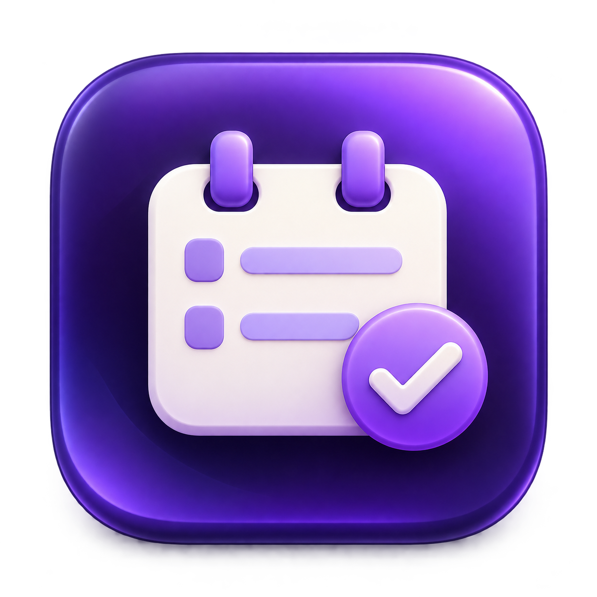

<p align="center">
  
</p>

# ObsidianPlannerForApple

把 Obsidian Day Planner 的时间安排同步到苹果提醒事项，并可选同步到日历。在 Mac 制定计划，回家后直接用 iPhone 查看，无需同步整个 Obsidian Vault。

A native macOS app that exports Obsidian Day Planner schedules to Apple Reminders, with optional Calendar events. View your plans on iPhone through iCloud without syncing the whole vault.

**Beta 软件 · Apple silicon · 未经 Apple 公证。** 当前只在开发者的 Mac 上完成主要流程验证，尚未全面验证其他 macOS 版本。

[下载最新版本 / Download](https://github.com/YuchenWang-leslie/ObsidianPlannerForApple/releases/tag/v0.1.0-beta.2) · [全部测试版本 / All releases](https://github.com/YuchenWang-leslie/ObsidianPlannerForApple/releases) · [MIT + Commons Clause](LICENSE)

> 首版为 Pre-release，建议先用少量安排验证结果。

## 功能

- 本周、下周、自定义日期范围（含过去日期）；每周从周一开始。
- 默认只生成 **DayPlanner 提醒事项**；可选同时生成 **DayPlanner 日历事件**。
- 默认提前 10 分钟提醒，可调整时间、关闭通知或选择通知渠道。
- 常用时区菜单、全部时区搜索，以及使用系统时区。
- 同步前预览；重复同步去重，支持明确匹配的改期、改标题和完成状态更新。
- 无法自动匹配时，可手动关联旧条目或明确作为新条目创建。
- 只读 Obsidian 文件，无服务器、无独立 App 账户。

## 安装与首次打开

1. 从 [Releases](https://github.com/YuchenWang-leslie/ObsidianPlannerForApple/releases) 下载 `ObsidianPlanner-…-macOS-arm64.zip`，解压。
2. 将 `ObsidianPlanner.app` 拖入「应用程序」。当前安装包适用于 **M 系列芯片 Mac**；未提供 Intel 安装包。
3. 尝试打开 App。如果 macOS 因开发者未经验证／未公证而阻止打开，可到 **系统设置 → 隐私与安全性 → 仍要打开**，核对 App 名称后确认。受组织管理的 Mac 可能不允许此操作。参见 [Apple 官方说明](https://support.apple.com/102445)。
4. 本 App 没有 Developer ID 签名，也没有经过 Apple 公证。仅在信任此项目时安装；无需关闭系统的整体安全保护。

**系统要求：** 构建最低目标为 macOS 14；当前主要实测环境为 Apple silicon / macOS 27.0.1，macOS 14–26 运行兼容性尚未验证。

## 使用方法

1. **Choose Vault…**：选择 Obsidian Vault。第一版读取根目录下的 `YYYY-MM-DD.md` 日记。
2. **Grant Reminders Access**：在系统弹窗中允许访问提醒事项，然后选择 iCloud 提醒事项账户。
3. 如需日历事件，勾选 **Also create calendar events**，再点击 **Grant Calendar Access** 并选择 iCloud 日历账户。两种权限独立。
4. 选择 **This Week / Next Week / Custom**，并确认 **Time zone**。选择范围包含起止两天。
5. 设置 **Notify via** 和提前分钟数。`None` 表示关闭本 App 创建的通知；`Both` 可能让两个 App 同时提醒。
6. 点击 **Preview** 检查安排，再点 **Sync to DayPlanner**。
7. Mac 和 iPhone 使用同一 Apple 账户，并开启 iCloud 提醒事项／日历后，等待苹果系统完成同步。

若同步按钮不可用，查看附近的提示，确认已选 Vault、已授予所需权限、已选择可写的 iCloud 账户。授权后可点 **Refresh Accounts** 刷新。选择日历账户之前必须先授予日历权限。

完成设置后，可以直接选择日期范围并同步。首次建议用一条无关紧要的安排验证结果。

### 支持的 Markdown

```markdown
# Day planner

- [ ] 09:00 - 10:30 Read papers
- [x] 11:00 - 11:30 Team meeting
```

- 日期来自文件名，时间使用 24 小时制，必须明确给出当天开始和结束时间。
- 会读取 Day Planner 配置中的标题和标题层级；默认 `# Day planner`。
- 无时间、仅开始时间、跨午夜、嵌套任务和其他非标准任务格式暂不支持，会提示跳过。
- 代码块、注释及目标标题节之外的内容不导出。重叠安排保留并提示。
- App 生成的备注显示 `Time: 09:00 – 10:30`；同步身份使用条目 URL 和本地历史维护。

## 注意事项与当前限制

- **单向同步：Obsidian → 苹果。** iPhone 的编辑和完成状态不会回写日记；检测到冲突的外部修改会跳过并显示原因。
- **不会自动删除。** 从 Markdown 删除安排、缩小日期范围，或关闭日历导出，都不会删除之前生成的苹果条目。
- 重复同步依赖本地历史：`~/Library/Application Support/ObsidianPlanner/`。请保留；暂不支持透明迁移 Vault 路径或完整的重装恢复。
- 旧版生成的技术备注会在所选日期范围的条目再次成功同步时清理。发生外部编辑冲突的条目可能需要先处理冲突。
- 本地历史与苹果对象不是一个原子事务；异常中断后的恢复没有全面验证。遇到部分失败，请先检查结果，再重试。
- 界面报告的是 Mac 本机写入结果，不表示 iPhone 已接收；实际到达时间和通知行为受 iCloud、网络及系统通知设置影响。
- 更新或重新编译后可能需要重新授予权限。提醒事项权限和日历权限分别在系统设置中管理。
- 「Connection test」是可选诊断功能，每次点击都会创建新测试条目；测试后可自行删除。
- 界面目前为英文。日期显示可能随系统语言变化。

## 隐私

App 在本机读取选定 Vault 的日记，保存同步映射并通过 EventKit 访问苹果日历／提醒事项。选定导出的标题、时间、备注和同步 URL 会写入你选择的苹果账户；选用 iCloud 时由苹果同步至你的其他设备。App 不提供自己的服务器或分析服务。运行时数据不属于源码仓库。

## 从源码构建 / Build from source

安装 Apple Swift 命令行工具后：

```sh
git clone https://github.com/YuchenWang-leslie/ObsidianPlannerForApple.git
cd ObsidianPlannerForApple
./scripts/test-core.sh
./scripts/build-app.sh
open dist/ObsidianPlanner.app
```

构建脚本使用当前机器的架构并进行本地临时签名。图标资源已包含；修改图标源文件后可运行 `./scripts/build-icon.sh` 重建 ICNS。

`swift test` 需要提供 XCTest 的开发环境（通常为完整 Xcode）。`test-core.sh` 使用 `swiftc` 运行独立测试，不依赖 XCTest。

## English quick start

Download the Apple silicon ZIP from Releases, unzip it, and move the app into Applications. This beta is ad-hoc signed and **not notarized**. If macOS blocks it, follow Apple's Privacy & Security → Open Anyway procedure after verifying the source.

Choose a vault containing root-level `YYYY-MM-DD.md` daily notes. Grant Reminders access and select iCloud. Calendar export is optional and requires separate Calendar permission. Pick a date range and time zone, preview, then sync. The default notification is 10 minutes before the schedule. Use the same Apple account with iCloud enabled on Mac and iPhone.

Only explicit same-day `- [ ] HH:mm - HH:mm Title` / `- [x] …` tasks are supported. Sync is one-way; source files are read-only. Source deletions do not remove exported items. Preserve the local Application Support history for deduplication. Conflicting outside edits are skipped. This beta has limited cross-version testing and no Intel release yet.

## Contributors

- [Yuchen Wang](https://github.com/YuchenWang-leslie) — 项目发起、需求设计、产品决策与实机验证。Project creator, product direction and on-device validation.
- **Codex (OpenAI)** — AI 编程助手，参与代码实现、界面与图标设计、测试、文档和发布准备。AI coding assistant contributing to implementation, UI and icon design, testing, documentation and release preparation.

## License and project notes

**MIT + Commons Clause v1.0 — source-available, not OSI open source.**

允许免费使用、学习、修改和分享，包括个人工作用途及企业内部使用。未经另行授权，不得销售本软件，或提供全部或实质价值来自本软件功能的收费产品／服务；仅改名、轻微修改后出售也受到限制。条款中的 Sell 包括符合上述条件的收费托管、咨询和支持服务；这不等于禁止所有商业活动。再分发须保留完整许可证及声明。

Free use, modification and sharing are permitted, including personal work and internal business use. Selling a product or service whose value derives entirely or substantially from this software requires separate permission. The definition includes applicable hosting, consulting and support fees. Preserve the complete license when redistributing. The [LICENSE](LICENSE) is authoritative; this summary does not replace it.

本仓库当前提供的版本均按上述组合条款分发；这不追溯撤销此前已经合法取得的授权。详见 [授权说明](docs/LICENSING.md)。

Not affiliated with Apple or Obsidian. The icon was generated with AI; [asset notes](Resources/Brand/README.md).

[开发设计](docs/DEVELOPMENT.md) · [阶段测试记录](docs/PROGRESS.md)
